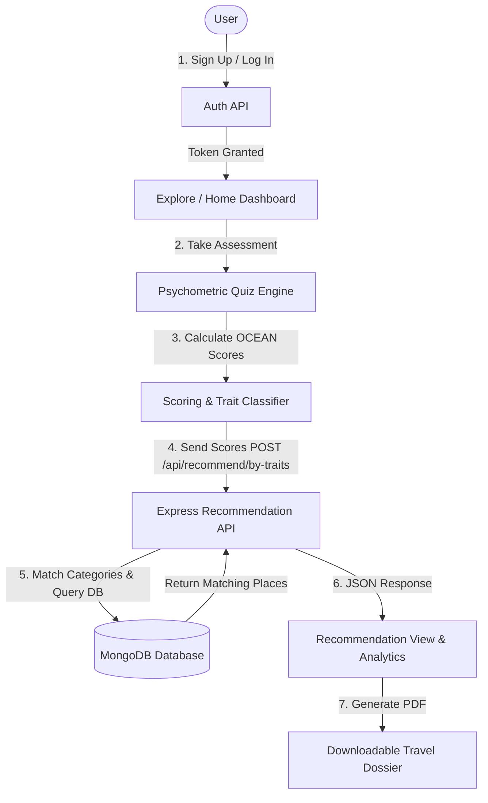

# 🌍 Trace — Psychometric & AI-Powered Travel Recommendation Platform

[](https://react.dev/)
[](https://nodejs.org/)
[](https://expressjs.com/)
[](https://www.mongodb.com/)
[](https://tailwindcss.com/)
[](https://www.framer.com/motion/)
[](https://opensource.org/licenses/MIT)

> **Trace** reimagines vacation and travel planning by connecting your inner psychological profile to the physical world. Leveraging the **Big Five (OCEAN)** psychometric personality model, Trace delivers curated, data-driven travel recommendations, personality analytics, and personalized downloadable itineraries.

---

## 🌟 Key Features

- 🧠 **Psychometric Personality Engine (OCEAN Model)**  
  An interactive, multi-step assessment that evaluates **Openness**, **Conscientiousness**, **Extraversion**, **Agreeableness**, and **Neuroticism** to craft your unique traveler DNA.
- 🎯 **Intelligent Destination Matching**  
  Algorithms map dominant personality traits directly to tailored destination categories (e.g., culturally immersive adventures for Openness, organized heritage tours for Conscientiousness, tranquil scenic retreats for Neuroticism/stress relief).
- 📊 **Dynamic Trait Visualizations**  
  Interactive trait charts and scores rendered with [Recharts](https://recharts.org/), breaking down psychological profiles with deep insight summaries.
- 📄 **One-Click Itinerary PDF Export**  
  Instant downloadable PDF dossiers containing personalized recommendations, destination descriptions, and trait analysis via `jspdf` and `html2canvas`.
- 🔐 **Secure User Authentication**  
  JWT-based authentication with bcrypt password hashing, session tokens, and React protected route guards.
- 💎 **Modern Glassmorphic UI & Smooth Animations**  
  Engineered with React 19, Tailwind CSS, Lucide icons, and Framer Motion micro-interactions.

---

## 🏗️ Architecture & Workflow



---

## 🗂️ Project Structure

```text
Trace/
├── client/                     # Frontend Application (React 19)
│   ├── public/                 # Static assets & index.html
│   └── src/
│       ├── components/         # UI Components & Page Views
│       │   ├── AboutUs.jsx
│       │   ├── ContactUs.jsx
│       │   ├── HomePage.jsx
│       │   ├── LoginPage.jsx
│       │   ├── PersonalityQuiz.jsx
│       │   ├── QuizFlow.jsx
│       │   ├── Recommendation.jsx
│       │   ├── ResultDownload.jsx
│       │   ├── ResultPage.jsx
│       │   ├── SignupPage.jsx
│       │   └── TourismPage.jsx
│       ├── App.js              # Application routing & navigation
│       ├── index.css           # Global design tokens & styling
│       └── index.js            # React root mount
│
├── server/                     # Backend API (Node.js & Express)
│   ├── models/                 # Mongoose Data Models
│   │   ├── Place.js            # Destination & Category Schema
│   │   └── User.js             # User & Credential Schema
│   ├── routes/                 # REST Endpoints
│   │   ├── auth.js             # Registration & Login routes
│   │   └── recommend.js        # Trait-based recommendation routes
│   ├── insertPlaces.js         # Initial database seed script
│   └── server.js               # Express application entrypoint
│
├── .gitignore                  # Git exclusions for dependencies & env files
└── README.md                   # Project documentation
```

---

## 🛠️ Tech Stack

### Frontend
- **Framework:** React 19
- **Routing:** React Router DOM (v7)
- **Styling:** Tailwind CSS & Vanilla CSS Design System
- **Animations:** Framer Motion
- **Visualizations:** Recharts
- **PDF Generation:** jsPDF & html2canvas
- **Icons:** Lucide React
- **HTTP Client:** Axios

### Backend
- **Runtime:** Node.js (v18+)
- **Framework:** Express.js
- **Database:** MongoDB & Mongoose ODM
- **Security:** bcryptjs, JSON Web Tokens (JWT)
- **CORS:** Cross-Origin Resource Sharing middleware

---

## 🚀 Getting Started

### Prerequisites
- [Node.js](https://nodejs.org/) (v18 or higher)
- [MongoDB](https://www.mongodb.com/) (Local Community Server or MongoDB Atlas cluster)
- [Git](https://git-scm.com/)

---

### 1. Clone the Repository

```bash
git clone https://github.com/MiruthulashreeM/Trace.git
cd Trace
```

---

### 2. Configure & Run Backend Server

1. Navigate to the `server` directory:
   ```bash
   cd server
   ```

2. Install dependencies:
   ```bash
   npm install
   ```

3. Create a `.env` file from the example:
   ```bash
   cp .env.example .env
   ```
   *Edit `.env` and set your MongoDB connection string:*
   ```env
   PORT=5000
   MONGO_URI=mongodb://localhost:27017/trace
   JWT_SECRET=your_jwt_secret_key_here
   ```

4. *(Optional)* Seed initial destination places into MongoDB:
   ```bash
   node insertPlaces.js
   ```

5. Start the backend server:
   ```bash
   npm start
   # Server runs on http://localhost:5000
   ```

---

### 3. Configure & Run Frontend Client

1. Open a new terminal and navigate to the `client` directory:
   ```bash
   cd client
   ```

2. Install dependencies:
   ```bash
   npm install
   ```

3. Start the React development server:
   ```bash
   npm start
   # Application opens at http://localhost:3000
   ```

---

## 📡 API Reference

### Authentication Routes (`/api`)
| Method | Endpoint | Description |
| :--- | :--- | :--- |
| `POST` | `/api/signup` | Registers a new user account with encrypted password |
| `POST` | `/api/login` | Authenticates credentials and returns a JWT token |

### Recommendation Routes (`/api/recommend`)
| Method | Endpoint | Payload | Description |
| :--- | :--- | :--- | :--- |
| `POST` | `/api/recommend/by-traits` | `{ scores: { trait0, trait1, ... } }` | Computes top dominant OCEAN traits and returns matched destination categories |

---

## 🤝 Contributing

Contributions are warmly welcomed! To contribute:

1. **Fork** the repository
2. **Create** your feature branch (`git checkout -b feature/AmazingFeature`)
3. **Commit** your changes (`git commit -m 'Add some AmazingFeature'`)
4. **Push** to the branch (`git push origin feature/AmazingFeature`)
5. Open a **Pull Request**

---

## 📄 License

This project is open source and available under the [MIT License](LICENSE).

---

<p align="center">
  Crafted with ❤️ by <a href="https://github.com/MiruthulashreeM">Miruthulashree M</a>
</p>
